# BloodMatch ERD

Generated from **bloodmatch_test:3306**, 2026-10-19 21:26 Asia/Manila. **TESTED DISPOSABLE SCHEMA - see application snapshot for rollout status**. 38 physical base tables.

The active design uses six donation tables. `donation_credits`, `donation_report_holds`, and `compatibility_matrix` remain as cutover source snapshots, not current writers. After separately approved retirement: 35 active base tables, including `compatibility_pairs`.

See [rollout and test checkpoint](DONATION_CONSOLIDATION_032.md), [data dictionary](data_dictionary.md), and [SVG](erd.svg). PK = primary key; FK = enforced reference; UK is shown on a column only for single-column uniqueness. Composite keys are listed in the dictionary.

```mermaid
erDiagram
    users ||--o| account_closures : "user_id"
    users |o--o{ audit_log : "actor_id"
    chapters |o--o{ blood_requests : "request_chapter_id"
    users ||--o{ blood_requests : "requester_id"
    hospitals |o--o{ blood_requests : "hospital_id"
    bataan_locations |o--o{ blood_requests : "location_id"
    blood_requests |o--o| blood_requests : "renewed_from_id"
    users |o--o{ chat_reports : "reporter_id"
    chat_reports ||--o{ chat_report_evidence : "report_id"
    users ||--o{ chat_requests : "user_low"
    users ||--o{ chat_requests : "user_high"
    users ||--o{ chat_requests : "sender_id"
    users ||--o{ chat_requests : "recipient_id"
    conversations ||--o{ conversation_participants : "conversation_id"
    users ||--o{ conversation_participants : "user_id"
    matches ||--o{ donation_chat_contexts : "match_id"
    conversations |o--o{ donation_chat_contexts : "conversation_id"
    users |o--o{ donation_chat_contexts : "accepted_by"
    donation_chat_contexts ||--o{ donation_coordination_events : "context_id"
    users |o--o{ donation_coordination_events : "actor_id"
    donation_reports ||--o{ donation_correction_requests : "report_id"
    users |o--o{ donation_correction_requests : "actor_id"
    users |o--o{ donation_correction_requests : "resolved_by"
    users ||--o{ donation_credits : "donor_id"
    matches ||--o| donation_credits : "match_id"
    donation_reports ||--o| donation_credits : "report_id"
    users |o--o{ donation_reports : "confirmed_by"
    users ||--o{ donation_reports : "donor_id"
    matches ||--o| donation_reports : "match_id"
    users |o--o{ donation_reports : "acknowledged_by"
    users |o--o{ donation_reports : "hold_released_by"
    matches ||--o| donation_reports : "match_id, donor_id"
    donation_chat_contexts |o--o{ donation_reports : "offer_context_id"
    users |o--o{ donation_report_events : "actor_id"
    donation_reports ||--o{ donation_report_events : "report_id"
    donation_reports ||--o{ donation_report_evidence : "report_id"
    users |o--o{ donation_report_evidence : "uploader_id"
    users ||--o{ donation_report_holds : "donor_id"
    users |o--o{ donation_report_holds : "released_by"
    donation_reports ||--o| donation_report_holds : "report_id"
    users ||--o{ donor_opportunities : "donor_id"
    notifications |o--o{ donor_opportunities : "notification_id"
    blood_requests ||--o{ donor_opportunities : "request_id"
    users ||--o| donor_response_state : "user_id"
    email_attempts ||--o| email_donor_reservations : "attempt_id"
    notifications ||--o| email_outbox : "notification_id"
    bataan_locations |o--o{ hospitals : "location_id"
    users ||--o{ matches : "donor_id"
    blood_requests ||--o{ matches : "request_id"
    users ||--o{ member_documents : "user_id"
    conversations ||--o{ messages : "conversation_id"
    users ||--o{ messages : "sender_id"
    users ||--o{ notifications : "user_id"
    users ||--o{ password_resets : "user_id"
    chapters |o--o{ users : "chapter_id"
    bataan_locations |o--o{ users : "location_id"
    users ||--o{ user_presence : "user_id"
    users |o--o{ verification_decisions : "officer_id"
    users ||--o{ verification_decisions : "target_user_id"
    account_closures {
        BIGINT user_id PK,FK
        DATETIME closed_at
        DATETIME erase_after
        DATETIME profile_erased_at "nullable"
    }
    audit_log {
        BIGINT id PK "auto_increment"
        BIGINT actor_id FK "nullable"
        VARCHAR action
        VARCHAR target_type "nullable"
        VARCHAR target_id "nullable"
        LONGTEXT context "nullable"
        TIMESTAMP created_at
    }
    auth_throttle {
        VARCHAR identifier PK
        INT failed_count
        DATETIME locked_until "nullable"
        TIMESTAMP updated_at "on update current_timestamp()"
    }
    bataan_locations {
        INT id PK "auto_increment"
        VARCHAR psgc_code UK
        VARCHAR name
        ENUM level
        VARCHAR municipality_code
        VARCHAR municipality_name
        DECIMAL latitude "nullable"
        DECIMAL longitude "nullable"
        TINYINT is_active
        TIMESTAMP created_at
        TIMESTAMP updated_at "on update current_timestamp()"
    }
    blood_requests {
        BIGINT id PK "auto_increment"
        BIGINT requester_id FK
        TINYINT request_chapter_id FK "nullable"
        ENUM required_blood_type
        TINYINT quantity_units
        VARCHAR facility_name
        INT hospital_id FK "nullable"
        DECIMAL latitude "nullable"
        DECIMAL longitude "nullable"
        ENUM urgency
        DATETIME needed_datetime
        ENUM status
        ENUM review_status
        TIMESTAMP created_at
        TIMESTAMP updated_at "on update current_timestamp()"
        DATETIME expired_at "nullable"
        INT location_id FK "nullable"
        TEXT description "nullable"
        BIGINT renewed_from_id UK,FK "nullable"
        VARCHAR closure_reason "nullable"
    }
    chapters {
        TINYINT id PK "auto_increment"
        VARCHAR code UK
        VARCHAR name
        VARCHAR municipality
        DECIMAL latitude "nullable"
        DECIMAL longitude "nullable"
        TIMESTAMP created_at
        TIMESTAMP updated_at "on update current_timestamp()"
    }
    chat_reports {
        BIGINT id PK "auto_increment"
        BIGINT reporter_id FK "nullable"
        BIGINT conversation_id "nullable"
        VARCHAR reason
        ENUM status
        VARCHAR findings "nullable"
        DATETIME created_at
        DATETIME resolved_at "nullable"
    }
    chat_report_evidence {
        BIGINT id PK "auto_increment"
        BIGINT report_id FK
        BIGINT message_id
        BIGINT sender_id "nullable"
        TEXT body
        DATETIME message_created_at
        TINYINT is_selected
    }
    chat_requests {
        BIGINT id PK "auto_increment"
        BIGINT user_low FK
        BIGINT user_high FK
        BIGINT sender_id FK
        BIGINT recipient_id FK
        ENUM status
        BIGINT conversation_id "nullable"
        DATETIME created_at
        DATETIME updated_at
    }
    compatibility_matrix {
        VARCHAR recipient_type PK
        TEXT allowed_donor_types
    }
    compatibility_pairs {
        ENUM recipient_type PK
        ENUM donor_type PK
        TINYINT preference_order
    }
    conversations {
        BIGINT id PK "auto_increment"
        VARCHAR type
        TIMESTAMP created_at
        TIMESTAMP updated_at "on update current_timestamp(3)"
    }
    conversation_participants {
        BIGINT id PK "auto_increment"
        BIGINT conversation_id FK
        BIGINT user_id FK
        DATETIME last_read_at "nullable"
        TIMESTAMP created_at
        BIGINT last_read_message_id "nullable"
    }
    donation_chat_contexts {
        BIGINT id PK "auto_increment"
        BIGINT match_id FK
        INT offer_cycle
        BIGINT conversation_id FK "nullable"
        BIGINT accepted_by FK "nullable"
        DATETIME accepted_at
        DATETIME responded_at
    }
    donation_coordination_events {
        BIGINT id PK "auto_increment"
        BIGINT context_id FK
        BIGINT actor_id FK "nullable"
        BIGINT actor_reference
        VARCHAR action
        INT report_version
        DATETIME created_at
    }
    donation_correction_requests {
        BIGINT id PK "auto_increment"
        BIGINT report_id FK
        INT content_version
        BIGINT actor_id FK "nullable"
        BIGINT actor_reference
        VARCHAR reason
        DATETIME created_at
        DATETIME resolved_at "nullable"
        BIGINT resolved_by FK "nullable"
        VARCHAR resolution "nullable"
    }
    donation_credits {
        BIGINT report_id PK,FK
        BIGINT match_id UK,FK
        BIGINT donor_id FK
        DATETIME occurred_at
        DATETIME recorded_at
        VARCHAR completion_basis
    }
    donation_reports {
        BIGINT id PK "auto_increment"
        BIGINT match_id UK,FK
        BIGINT donor_id FK
        VARCHAR report_note "nullable"
        VARCHAR rejection_reason "nullable"
        ENUM status
        DATETIME reported_at
        BIGINT confirmed_by FK "nullable"
        DATETIME confirmed_at "nullable"
        TIMESTAMP created_at
        VARCHAR review_evidence "nullable"
        DATETIME occurred_at "nullable"
        INT content_version
        VARCHAR workflow_state
        VARCHAR requester_response "nullable"
        BIGINT acknowledged_by FK "nullable"
        DATETIME acknowledged_at "nullable"
        INT acknowledged_version "nullable"
        DATETIME reviewed_at "nullable"
        VARCHAR completion_basis "nullable"
        DATETIME reminder_sent_at "nullable"
        DATETIME escalated_at "nullable"
        BIGINT offer_context_id FK "nullable"
        DATETIME credit_recorded_at "nullable"
        DATETIME hold_started_at "nullable"
        DATETIME hold_released_at "nullable"
        BIGINT hold_released_by FK "nullable"
        VARCHAR hold_release_basis "nullable"
        VARCHAR hold_release_type "nullable"
        BIGINT credited_donor_id "nullable; STORED GENERATED"
        DATETIME credited_occurred_at "nullable; STORED GENERATED"
    }
    donation_report_events {
        BIGINT id PK "auto_increment"
        BIGINT report_id FK
        INT content_version
        BIGINT actor_id FK "nullable"
        BIGINT actor_reference "nullable"
        VARCHAR event_type
        VARCHAR basis "nullable"
        LONGTEXT snapshot_json
        DATETIME created_at
    }
    donation_report_evidence {
        BIGINT id PK "auto_increment"
        BIGINT report_id FK
        INT content_version
        BIGINT uploader_id FK "nullable"
        INT retired_version "nullable"
        CHAR stored_name UK
        VARCHAR mime_type
        VARCHAR original_ext
        INT size_bytes
        DATETIME uploaded_at
    }
    donation_report_holds {
        BIGINT report_id PK,FK
        BIGINT donor_id FK
        DATETIME started_at
        DATETIME released_at "nullable"
        BIGINT released_by FK "nullable"
        VARCHAR release_basis "nullable"
        VARCHAR release_type "nullable"
    }
    donor_opportunities {
        BIGINT id PK "auto_increment"
        BIGINT request_id FK
        BIGINT donor_id FK
        INT generation
        BIGINT notification_id FK "nullable"
        DATETIME notified_at
        DATETIME due_at
        ENUM status
    }
    donor_response_state {
        BIGINT user_id PK,FK
        DATETIME standby_started_at "nullable"
        DATETIME consumed_through "nullable"
    }
    email_attempts {
        BIGINT id PK "auto_increment"
        ENUM mail_class
        DATETIME attempted_at
    }
    email_donor_reservations {
        BIGINT attempt_id PK,FK
        BIGINT donor_id
        DATETIME reserved_at
        ENUM outcome
        DATETIME updated_at
    }
    email_outbox {
        BIGINT id PK "auto_increment"
        BIGINT notification_id UK,FK
        VARCHAR delivery_key UK
        ENUM priority
        ENUM status
        SMALLINT attempts
        DATETIME next_attempt_at
        CHAR lease_token "nullable"
        DATETIME lease_expires_at "nullable"
        DATETIME expires_at
        VARCHAR last_error_code "nullable"
        VARCHAR cancel_reason "nullable"
        DATETIME created_at
        DATETIME updated_at
        DATETIME sent_at "nullable"
    }
    hospitals {
        INT id PK "auto_increment"
        VARCHAR name
        ENUM type
        VARCHAR municipality_name
        INT location_id FK "nullable"
        TIMESTAMP created_at
        TIMESTAMP updated_at "on update current_timestamp()"
    }
    matches {
        BIGINT id PK "auto_increment"
        BIGINT request_id FK
        BIGINT donor_id FK
        INT generation
        ENUM status
        DECIMAL distance_km "nullable"
        DECIMAL rank_score "nullable"
        TIMESTAMP created_at
        TIMESTAMP updated_at "on update current_timestamp()"
        DATETIME responded_at "nullable"
        INT offer_cycle
    }
    member_documents {
        BIGINT id PK "auto_increment"
        BIGINT user_id FK
        ENUM doc_type
        CHAR stored_name UK
        VARCHAR mime_type
        VARCHAR original_ext
        INT size_bytes
        TIMESTAMP uploaded_at
    }
    messages {
        BIGINT id PK "auto_increment"
        BIGINT conversation_id FK
        BIGINT sender_id FK
        TEXT body
        TIMESTAMP created_at
    }
    notifications {
        BIGINT id PK "auto_increment"
        BIGINT user_id FK
        VARCHAR type
        VARCHAR title
        VARCHAR body
        VARCHAR related_type "nullable"
        BIGINT related_id "nullable"
        VARCHAR dedup_key "nullable"
        INT generation "nullable"
        DATETIME emailed_at "nullable"
        DATETIME read_at "nullable"
        TIMESTAMP created_at
    }
    password_resets {
        BIGINT id PK "auto_increment"
        BIGINT user_id FK
        CHAR token_hash UK
        DATETIME expires_at
        DATETIME used_at "nullable"
        TIMESTAMP created_at
    }
    pending_registrations {
        BIGINT id PK "auto_increment"
        VARCHAR email UK
        LONGTEXT payload_json
        LONGTEXT document_json "nullable"
        VARCHAR code_hash
        DATETIME code_expires_at
        DATETIME expires_at
        DATETIME created_at
    }
    schema_migrations {
        VARCHAR name PK
        TIMESTAMP applied_at
    }
    system_settings {
        VARCHAR setting_key PK
        VARCHAR value
        TIMESTAMP updated_at "on update current_timestamp()"
    }
    users {
        BIGINT id PK "auto_increment"
        VARCHAR email UK
        VARCHAR password_hash "nullable"
        VARCHAR first_name
        VARCHAR middle_name "nullable"
        VARCHAR last_name
        VARCHAR full_name "nullable; STORED GENERATED"
        VARCHAR phone "nullable"
        ENUM role
        TINYINT chapter_id FK "nullable"
        ENUM verification_status
        DATE date_of_birth "nullable"
        ENUM blood_type "nullable"
        ENUM blood_type_source "nullable"
        TINYINT blood_type_verified
        DATETIME donor_enrolled_at "nullable"
        ENUM donor_availability "nullable"
        DATETIME last_verified_donation_at "nullable"
        DECIMAL latitude "nullable"
        DECIMAL longitude "nullable"
        ENUM account_status
        DATETIME email_verified_at "nullable"
        VARCHAR email_code_hash "nullable"
        DATETIME email_code_expires_at "nullable"
        DATETIME deactivated_at "nullable"
        TIMESTAMP created_at
        TIMESTAMP updated_at "on update current_timestamp()"
        VARCHAR profile_picture "nullable"
        INT location_id FK "nullable"
    }
    user_presence {
        CHAR session_key PK
        BIGINT user_id FK
        DATETIME last_seen_at
    }
    verification_decisions {
        BIGINT id PK "auto_increment"
        BIGINT target_user_id FK
        BIGINT officer_id FK "nullable"
        ENUM decision
        VARCHAR reason "nullable"
        TIMESTAMP created_at
    }
```

Optionality is read from nullable FKs; maximum child cardinality is inferred from actual unique keys. The tested 032 design adds a composite donor/match FK and context identity triggers; 033 makes accepted context identity immutable. These guarantees apply only to targets with the respective migration markers. Context deletion continues using SET NULL.

Logical references without FKs: audit/notification polymorphic targets; donor reservation donor accounting references; chat report conversation/message snapshots; participant read watermark; preserved actor references. Disconnected infrastructure tables (throttles, settings, migration ledger, pending registrations, compatibility reference) intentionally have no user ownership FK.
