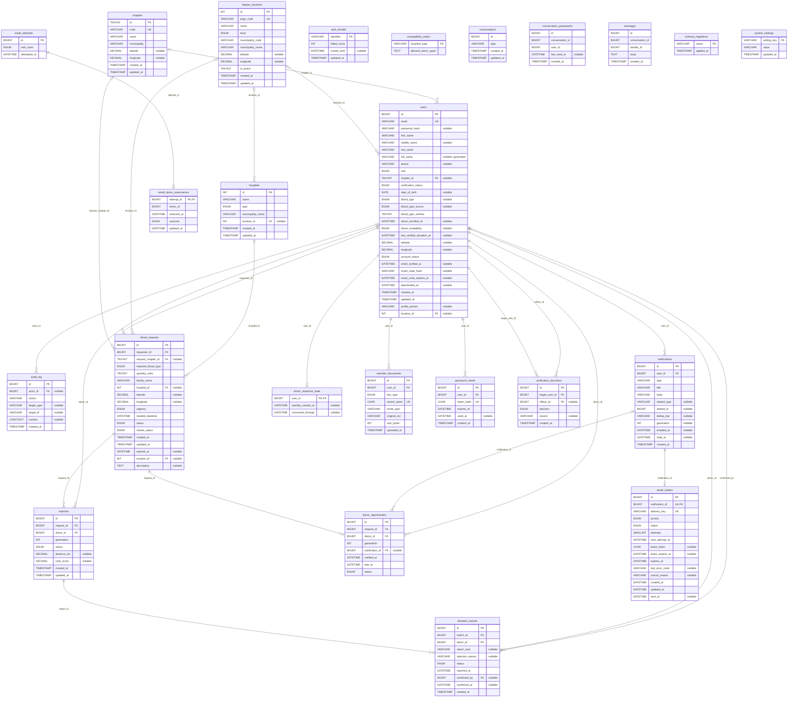

# BloodMatch entity relationship diagram

Generated from the actual `bloodmatch` schema on port 3306, 14 October 2026 19:07 Asia/Manila. This snapshot includes all 24 base tables; account count does not change its relationships.

**Import repair pending:** these tables have no primary key: `conversations`, `conversation_participants`, `messages`. Chat foreign keys are also absent in this snapshot. Run the reviewed maintenance and regenerate this file before submitting the final ERD.

[Open the SVG diagram](erd.svg). PK = primary key; FK = enforced foreign key; UK = single-column unique key. Nullable FK fields permit an absent parent.

## Relationships not enforced by foreign keys

- `notifications.related_type` / `related_id` and `audit_log.target_type` / `target_id` are polymorphic application references.
- `email_donor_reservations.donor_id` is a deliberate accounting reference without a user FK; cleanup explicitly handles removed donors.
- `auth_throttle.identifier` contains opaque throttle keys, rather than an enforced user relationship.
- `compatibility_matrix.allowed_donor_types` stores the fixed reference compatibility list used by the matching service.

## Chat repair target

The intended relationship is `users -> conversation_participants -> conversations -> messages`, with a separate sender FK from `messages` to `users`. Chat IDs require primary keys and automatic generation; participant pairs require uniqueness. `last_read_at` must be DATETIME(3). The exporter includes these edges only after the actual database has them.

No tables or columns were removed to simplify this diagram. See [the database review and execution guide](CHAT_DATABASE_NOTIFICATION_HANDOFF.md).
